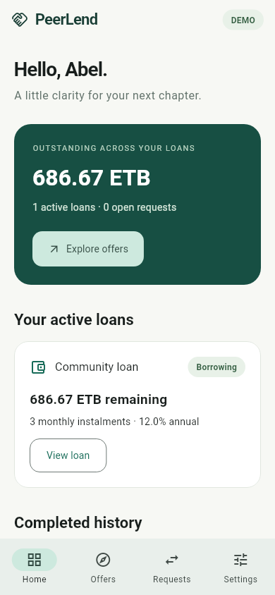
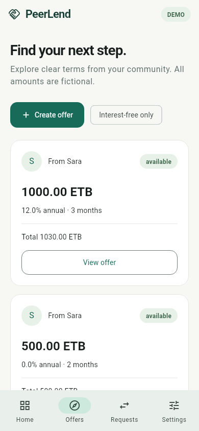

# PeerLend

A Flutter classroom prototype for arranging fictional peer loans, reviewing shared terms, and confirming repayments. No real money moves. Milestone 1 uses in-memory data only.

## Preview

| Home | Offers |
|---|---|
|  |  |

[Desktop preview](docs/screenshots/home-desktop.png)

## Run

Use the course toolchain: **Flutter 3.47.7 / Dart 3.13.5** or a compatible newer SDK.

```sh
flutter pub get
flutter run
```

Choose an Android emulator, iOS simulator (macOS), or Chrome. For a browser demo:

```sh
flutter run -d chrome
```

Generated Freezed files are committed. After editing a model:

```sh
dart run build_runner build
dart format lib test tool
```

The locked Freezed 3.2.5 generator may report that its analyzer supports an older Dart language version. Model generation succeeds with the course SDK. `Loan` uses Freezed's classic constructor syntax and defensively copies its schedule.

## Demo accounts

| Participant | Email | Password |
|---|---|---|
| Abel | `abel@demo.test` | `demo1234` |
| Sara | `sara@demo.test` | `demo1234` |

The sign-in screen also has quick demo buttons. Both accounts can borrow and lend. Sara owns the first two offers; Abel and Sara share a sample loan. Registration creates another in-memory account. These are fictional credentials, not production authentication.

Changes survive navigation and signing out so the other participant can confirm them. Restarting the app resets all records. Signing out hides private screens; preferences are scoped to each account.

## Demonstration walkthrough

1. Continue as **Abel**, open **Offers**, inspect the 1,000 ETB offer, and choose **Send request**.
2. Open **Settings**, sign out, and continue as **Sara**. Open **Requests** and approve Abel's request.
3. Sign out and continue as **Abel**. Open **Requests** and choose **Confirm terms & create loan**.
4. Open the loan's **Record repayment** form, choose an instalment, enter its amount and a date, optionally add a typed note/sample receipt, and save.
5. The balance stays unchanged until **Sara** opens that loan and chooses **Confirm repayment**.
6. In **Offers**, choose **Create offer** to publish your own terms. Open that offer to edit it.
7. Choose **Explain these terms** on an offer and enable consent to view a local simulated explanation.
8. In **Settings**, use **Demo data state** to demonstrate loading, empty, error, and offline states. Use Normal to restore ordinary interaction.

The sample loan starts with its first instalment confirmed, leaving **686.67 ETB**. Only confirmed repayments reduce a balance. Completed loans move into the home screen's history section.

Camera capture, password-recovery email, notifications, and AI responses are simulated or explanatory placeholders in M1. No camera permission, network request, or persistent storage is used.

## Screen map

| Screen | Route |
|---|---|
| Sign in | `/sign-in` |
| Register | `/register` |
| Recovery help | `/recovery` |
| Home / loan history | `/home` |
| Offer list | `/offers` |
| Create offer | `/offers/new` |
| Offer detail / request | `/offers/:offerId` |
| Edit offer | `/offers/:offerId/edit` |
| Requests / confirmation | `/requests` |
| Loan detail | `/loans/:loanId` |
| Record repayment / simulated camera | `/loans/:loanId/repayments/new` |
| Explanation / consent | `/offers/:offerId/explanation` |
| Settings | `/settings` |

`go_router` provides authentication redirects, parameterized detail routes, missing-record recovery, bottom navigation on phones, and a navigation rail on wider screens. Direct links to protected screens return there after sign-in. Private loan routes check the current participant.

## Code structure

```text
lib/
  core/
    providers/       # demonstration data state
    router/          # routes, auth redirects, navigation shell
    theme/           # shared Material theme
    widgets/         # common layout and data-state widgets
  features/
    auth/
    offers/
    requests/
    loans/
    repayments/
    explanations/
    settings/
```

Each feature contains:

- `domain`: immutable Freezed models, repository/service contracts, and business calculations.
- `data`: seeded in-memory repository or fake service implementations.
- `presentation`: screens and Riverpod controllers/providers.

The root `ProviderScope` owns application state. Widgets observe providers and call controller actions. Controllers validate rules, write through repository interfaces, and publish fresh immutable snapshots. Text controllers and unsaved form selections remain local UI state; saved records, account state, filters, settings and workflow decisions belong to providers.

Amounts use integer minor units, rates use basis points, and simple interest is rounded once. The final instalment absorbs the rounding remainder. For 1,000 ETB at 12% over three months, the schedule is 343.33, 343.33, 343.34 ETB.

A request captures its terms. Approval reserves an offer and declines competing pending requests. A borrower then confirms those same terms to create one loan. Edited terms require a new request. Repayments cannot exceed unrecorded instalment amounts, and the recorder cannot confirm their own repayment.

Repository interfaces are seams for M2; production authentication, access control and atomic server transactions still need to be implemented then.

## Verification

```sh
flutter analyze --fatal-infos
flutter test
flutter build web --no-wasm-dry-run
```

There are **31 unit/widget tests** covering calculations and rounding, immutable models, authentication, repository overrides, workflow permissions, duplicate decisions, payment confirmation, account preferences, routes, forms, consent, data states, and small/wide layouts.

The development sandbox disallows localhost sockets, preventing the standard Flutter test runner from starting. The same tests can also run directly in Flutter's Linux headless engine:

```sh
bash tool/test_headless.sh
```

Set `PEER_LEND_FLUTTER_BIN` to select another Flutter executable. This optional fallback uses the installed SDK and package configuration without opening sockets. Its runner imports the four current test files; add imports/groups there when introducing another test file. It is additional verification, not the required standard test output for submission.

See [MILESTONE.md](MILESTONE.md) for actual results, remaining submission work, and the group review table. Do not tag `m1` until the group completes PR reviews and captures passing standard analyzer/test output for the final submission code.
